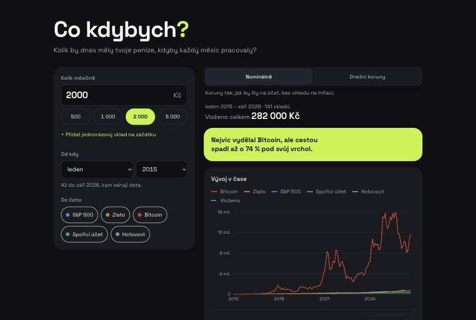
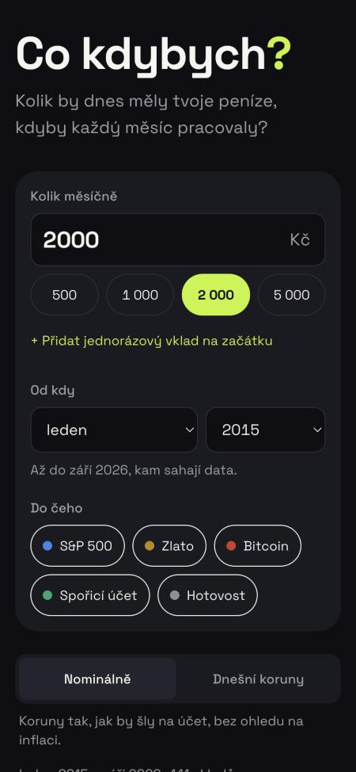
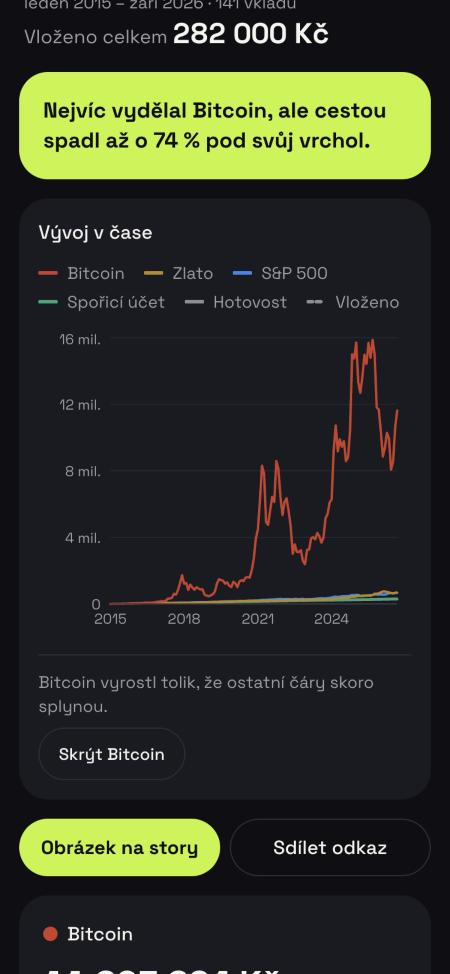
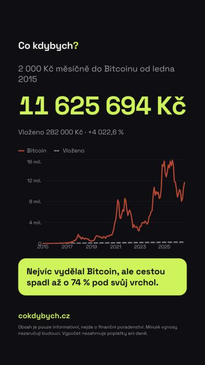

# Co kdybych?

**Kolik by dnes měly tvoje peníze, kdyby každý měsíc pracovaly?**

Webová kalkulačka pro mladé Čechy. Zadáš měsíční částku, od kdy a do čeho, a uvidíš, kolik by z toho dnes bylo. Porovnává S&P 500 s reinvesticí dividend, zlato, Bitcoin, spořicí účet a hotovost „pod polštářem“, a to na skutečných měsíčních datech od roku 2000. Výsledek jde ukázat nominálně, nebo v dnešních korunách očištěných o inflaci. Výsledek jde sdílet odkazem nebo jako obrázek na Instagram story.

_A Czech "what if I had invested" calculator: regular monthly investing into the S&P 500, gold, Bitcoin, a savings account or cash, on real monthly data, nominal or inflation-adjusted, with shareable links and an Instagram story image generated in the browser._

**Živá verze: [cokdybych.cz](https://cokdybych.cz)** · příklad sdíleného odkazu: [5 000 Kč měsíčně od roku 2020 v dnešních korunách](https://cokdybych.cz/?mesicne=5000&od=2020-01&aktiva=sp500,zlato,bitcoin,sporak,hotovost&realne=1)

| Počítač | Mobil: zadání | Mobil: výsledky | Story obrázek |
| --- | --- | --- | --- |
|  |  |  |  |

## Co umí

- **Pravidelné investování:** měsíční částka v Kč (výchozí 2 000 Kč), volitelný jednorázový vklad na začátku, start od prosince 1999 do posledního měsíce s daty.
- **Pět aktiv vedle sebe:** S&P 500 (s reinvesticí dividend), zlato, Bitcoin, spořicí účet, hotovost.
- **Nominálně, nebo v dnešních korunách:** v druhém režimu se inflací přepočítá i každý vklad, ne jen konečná hodnota.
- **Pro každé aktivum:** vloženo celkem, hodnota dnes, zisk v Kč a %, roční zhodnocení (XIRR) a největší propad cestou (max drawdown) i s obdobím.
- **Graf v čase:** všechna aktiva a čára „kolik jsem vložil“. Když Bitcoin ostatní čáry zplacatí, nabídne se jeho skrytí.
- **Věta s poučením:** generují ji pevná pravidla, žádná AI. Třeba „Nejvíc vydělal Bitcoin, ale cestou spadl až o 74 % pod svůj vrchol.“
- **Sdílení:** odkaz se všemi vstupy v URL a obrázek 1080×1920 na story. Na mobilu se sdílí přes systémové menu, jinde se stáhne jako PNG.
- **Poctivá data:** aktivum, které pro zvolený start nemá data (Bitcoin před 12/2014), se nepočítá a stránka to řekne.
- **Mobile-first, česky:** české formátování čísel (`1 234 567 Kč`), texty bez předpokladu rodu čtenáře.

## Technologie

| | Proč |
| --- | --- |
| **Next.js 16** (App Router), **React 19**, **TypeScript** | Jedna statická stránka z CDN. Výpočet běží v prohlížeči, takže žádný server, databáze ani API za běhu. |
| **Tailwind CSS 4** | Barvy brandu žijí v jednom souboru [`src/brand.config.ts`](src/brand.config.ts), layout z nich udělá CSS proměnné a Tailwind třídy. |
| **Recharts 3** | Graf. Načítá se líně, aby se čísla ukázala dřív: úvodní JavaScript je díky tomu asi o 100 kB (gzip) menší. |
| **html-to-image** | Story obrázek vzniká v prohlížeči z běžné React komponenty. |
| **Vitest** | Testy výpočtů, parsování dat, URL a textů, včetně případů ověřitelných na kalkulačce. |
| **Node.js (type stripping)** | Datový skript v TypeScriptu běží přímo v Node 22.18+, bez buildu a bez Pythonu. |

## Zdroje dat

Data stahuje skript [`scripts/fetch-data.ts`](scripts/fetch-data.ts) do [`src/data/market.json`](src/data/market.json) (~20 kB). Aplikace za běhu nic nestahuje.

| Data | Zdroj | Poznámka |
| --- | --- | --- |
| Kurz USD/CZK | [Česká národní banka](https://www.cnb.cz/cs/financni-trhy/devizovy-trh/kurzy-devizoveho-trhu/) | Kurz posledního pracovního dne v měsíci. |
| Inflace (CPI) | [Český statistický úřad](https://csu.gov.cz/produkty/isc_cr) | Bazický index 2015 = 100. Nová sada CEN0101E a archiv 010022, skript ověřuje jejich shodu na překryvu. |
| S&P 500 | [Alpha Vantage](https://www.alphavantage.co/) – ETF SPY | Cena upravená o dividendy (reinvestice). Odpovídá S&P 500 Total Return minus poplatek fondu 0,0945 % ročně. |
| Zlato | [Světová banka – Pink Sheet](https://www.worldbank.org/en/research/commodity-markets) | USD za trojskou unci, **měsíční průměr**. |
| Bitcoin | [FRED – Coinbase (CBBTCUSD)](https://fred.stlouisfed.org/series/CBBTCUSD) | Poslední denní cena v měsíci, od prosince 2014. |
| Spořicí účet | [ČNB ARAD](https://www.cnb.cz/arad/) | Řada SMIRNOOBVKMIRS405CZK1: průměrná sazba nových úsporných vkladů na požádání (včetně spořicích účtů). Bez API klíče aplikace počítá s nastavitelným odhadem a jasně ho označí. |

**Proč ne Yahoo Finance nebo Stooq:** oba weby skripty aktivně blokují. Obcházet jejich ochranu by bylo proti pravidlům webu a křehké, proto používám oficiální a otevřené zdroje.

Skript při každém běhu:
- spouští všechny zdroje najednou a nahlásí všechny chyby, takže v repozitáři nikdy neskončí napůl stažená data,
- zahodí rozběhnutý měsíc a nedoplňuje mezery (když chybí měsíc, spadne a řekne, kde),
- upozorní na podezřele velké měsíční skoky,
- vypíše kontrolní hodnoty k ručnímu ověření.

## Jak se počítá

- **Vklady:** každý měsíc na konci měsíce, včetně prvního a posledního. Vloženo = počet měsíců × částka (+ jednorázový vklad).
- **Aktiva v dolarech:** každý vklad se převede kurzem ČNB daného měsíce a koupí se za něj podíl za tehdejší cenu. Hodnota = podíly × cena × kurz.
- **Spořicí účet:** měsíční úročení sazbou daného měsíce (roční / 12) a k tomu nový vklad.
- **Hotovost:** jen součet vkladů.
- **Dnešní koruny:** každá částka z měsíce _t_ se vynásobí CPI(konec) / CPI(_t_). Vklady i hodnoty jsou pak ve stejné kupní síle a zisk znamená, že si za výsledek opravdu koupíš víc než za vklady.
- **Roční zhodnocení (XIRR):** sazba, při které by všechny vklady zúročené do konce daly konečnou hodnotu. Na rozdíl od prostého průměru bere ohled na to, že první koruna pracovala roky a poslední měsíc. Počítá se bisekcí: u pravidelného investování má rovnice jediné řešení.
- **Největší propad:** z ceny jednoho podílu v korunách, ne ze zůstatku. Nové vklady by jinak propad maskovaly.
- **Konec:** poslední měsíc, pro který existují všechna data. Hodnoty platí ke konci toho měsíce.
- **Věta s poučením:** platí první pravidlo, které sedí. Vítěz s propadem nad 30 %, inflace sežrala hotovost, vítěz bez velkého propadu, vyhrála jistota, nevydělalo nic.
- **Bez poplatků a daní.**

## Spuštění

Vyžaduje Node.js 22.18+.

```bash
npm install
npm run dev        # http://localhost:3000
```

| Příkaz | Co dělá |
| --- | --- |
| `npm run dev` | vývojový server |
| `npm test` | testy (Vitest) |
| `npm run lint` / `npm run typecheck` | ESLint / TypeScript |
| `npm run build` | produkční build |
| `npm run data` | stáhne nová data a vypíše kontrolní hodnoty |

### Aktualizace dat

1. Zkopíruj `.env.example` do `.env.local` a doplň bezplatné klíče: [Alpha Vantage](https://www.alphavantage.co/support/#api-key) (povinný) a ČNB ARAD (volitelný, [jak ho získat](https://www.cnb.cz/arad/docs/api/api-key.html)).
2. Spusť `npm run data`, zkontroluj vypsané hodnoty a commitni `src/data/market.json`.

## Struktura

```
scripts/
  fetch-data.ts          stažení, kontrola a uložení dat
  sources/               jeden soubor na zdroj (+ testy parserů)
  lib/                   měsíce, CSV, HTTP, skládání řad
src/
  brand.config.ts        barvy, barvy aktiv, adresa webu, disclaimer
  data/market.json       měsíční řady + zdroje
  lib/calc/              simulace, XIRR, drawdown, věta s poučením (čisté funkce + testy)
  lib/                   formátování, vstupy, URL, data pro graf a obrázek
  components/            formulář, výsledky, graf, sdílení, story obrázek
  app/                   stránka, layout, OG obrázek, ikony, robots, sitemap
assets/fonts/            Space Grotesk pro generované obrázky (SIL OFL)
```

## Omezení

- **Spořák:** bez klíče k ČNB ARAD se počítá se stálou sazbou nastavenou uživatelem (výchozí 2 % ročně). Stránka ji označuje jako odhad.
- **Zlato:** používám měsíční průměr, ne závěrečnou cenu. Rozdíl bývá 1–2 %.
- **S&P 500:** ETF SPY obsahuje svůj poplatek 0,0945 % ročně.
- **Instagram:** vestavěný prohlížeč Instagramu sdílení souborů často neumí. Obrázek jde v náhledu podržet a uložit.

---

Obsah je pouze informativní, nejde o finanční poradenství. Minulé výnosy nezaručují budoucí. Výpočet nezahrnuje poplatky ani daně.

Font Space Grotesk © The Space Grotesk Project Authors, [SIL Open Font License 1.1](assets/fonts/OFL.txt).
